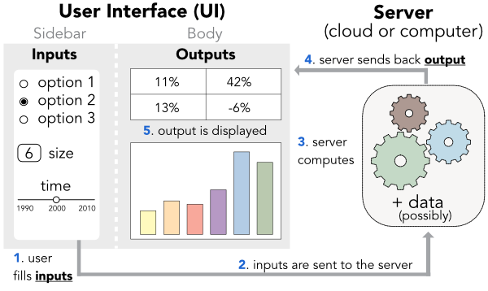

::: page-head
[[Teaching](teaching.html)]{.crumb}

# Coding dynamic dashboard applications (with R & Shiny)

Teaching material for a course on dynamic dashboards.
:::

## Sessions

Each session links to HTML **slides** and course **material**.

::: sessions
1. Introduction to **R/RStudio** and the **tidyverse** (tidying with tidyr, wrangling with dplyr) [[Slides](files/shiny/S1_tidyverse.html) [Sample notebook (Rmd)](files/shiny/notebook_options.Rmd) [Sample notebook (html)](files/shiny/notebook_options.html)]{.links}
1. **Basic R instructions** (matrices, dataframes, indexing, data modes) [[Slides](files/shiny/S2_base.html) [Sample notebook](files/shiny/movies_script.Rmd) [Exercise notebook](files/shiny/Tidyverse_exercises_2.Rmd)]{.links}
1. **Plots** (ggplot, gganimate, plotly) [[Slides](files/shiny/S3_plots.html) [Exercises (Rmd)](files/shiny/S3_exercises.Rmd)]{.links}
1. **Shiny 1** (User Interface & Server dialog) [[Slides](files/shiny/S4_ui_server.html) [Exercises](files/shiny/S4_exercises.html) [**Examples**](files/shiny/steps4.zip)]{.links}
1. **Shiny 2** (User Interface layout) [[Slides](files/shiny/S5_UI_layout.html) [Exercises](files/shiny/S5_exercises.html) [**Examples**](files/shiny/steps5.zip)]{.links}
1. **Shiny 3** (Further options & deployment) [[Slides](files/shiny/S6_deploy.html) [**Examples**](files/shiny/steps6.zip)]{.links}
1. **Geocomputing, Twitter data & simple text mining** [[Notebook for maps](files/shiny/geocomputing.nb.html) [Notebook for Mastodon text analysis](files/shiny/Mastodon_text.nb.html) [All files for the maps](files/shiny/geocomputing.zip)]{.links}
1. **Modelling** & **case study** [[All files (zipped)](files/shiny/S8.zip)]{.links}
:::

## Datasets

The datasets used in the course: [**songs**](files/shiny/songs.RData), [**movies**](files/shiny/movies.RData) and [**olympics**](files/shiny/olympics.RData). Don't forget to locate them in the app/notebook directory.

## Resources

- [**Mastering shiny**](https://mastering-shiny.org): Hadley Wickham's book
- [**Shiny tutorials**](https://shiny.rstudio.com/tutorial/): efficient material (by RStudio)
- [**Shiny dashboard**](https://rstudio.github.io/shinydashboard/): the package's webpage

::: disclaimer
The data and code are meant for pedagogical use only.
:::
